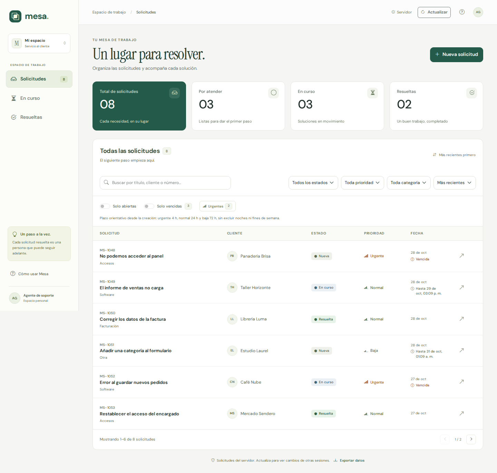
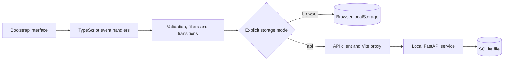

# Mesa — Bootstrap SupportDesk

A responsive request workspace built with **Bootstrap 5.3, SCSS and TypeScript**. Create a request, find it through combined filters, start work, document the resolution and keep its history when reopening.



[Watch the recorded workflow](docs/demo.webm) · [Validation and environment](docs/VALIDATION.md) · [Optional hands-on practice](docs/LEARNING.md)

**Browser release v0.2.0:** completed single-agent browser application with synthetic data and browser-local persistence. Local type checks, unit tests, production build and browser checks passed on October 29, 2026. That release has no API, shared database, authentication or cloud backend.

**API release v0.3.0:** optional local FastAPI + SQLite storage, selected explicitly with `VITE_MESA_STORAGE=api`. The default browser mode is retained. The frontend type check, 55 frontend unit tests, 48 backend tests, both production builds, 15 browser-mode journeys and six API-mode journeys passed locally on October 29, 2026. A real-process restart check also preserved the full request, resolution and history. The application and extension are built with AI assistance; optional learner exercises are tracked separately from software implementation and verification.

## Run the default browser mode

Node.js **22.12+** is required. From this directory:

```bash
npm ci
npm run dev
```

Open the printed local URL, normally <http://127.0.0.1:4173>. The development server also listens on the LAN at `http://<your-LAN-IP>:4173`; use the address of the machine running Vite. To serve the production build, use `npm run build`, then `npm run preview` on port 4174.

Browser data is tied to the origin: localhost and the LAN address have separate stored requests even on the same browser.

On the current Codex workspace, Node is available in `/tmp/cartagena-node/bin`; add that directory to `PATH` when your shell cannot find `node`. The [local launcher](scripts/start-local.sh) handles this workspace fallback automatically.

## Run with the local API

See [API setup, contract and recovery](docs/API.md) for complete instructions. From the project directory, install the Python dependencies once:

```bash
python3 -m venv backend/.venv
backend/.venv/bin/python -m pip install -r backend/requirements-dev.txt
```

Keep the backend running in one terminal:

```bash
backend/.venv/bin/python -m uvicorn backend.app:app --host 127.0.0.1 --port 8000
```

In a second terminal:

```bash
npm run dev:api
```

After installation, `bash scripts/start-fullstack.sh` is an alternative that starts the backend, waits for its health endpoint and starts the API frontend. It stops its owned backend when the launcher exits. Set `MESA_API_PYTHON` if using a different Python environment.

Vite forwards `/api` to `127.0.0.1:8000`. API mode stores requests in `backend/data/mesa.sqlite3`, or the path supplied through `MESA_DB_PATH`. The backend seeds fictional requests only when first initializing its database. The frontend never imports browser records or silently falls back to browser mode if the API is unavailable.

This extension is for local development with synthetic data. It has no authentication or cloud deployment. Vite's LAN address also exposes the proxied API to that network. Demo reset is disabled in API mode; there is no API reset/delete endpoint.

For a production preview of the API frontend, run `npm run build:api`, then `npm run preview:api` with the backend still running. API assets use `dist-api`; the browser build remains in `dist`. Vite replaces `VITE_` values at build time; changing an environment variable only when launching preview does not change an already-built frontend.

## What works

- Responsive Bootstrap grid, request table and mobile cards, forms, modal, offcanvas and toast feedback.
- A compiled SCSS theme with Bootstrap variable overrides and a reusable priority-color mixin.
- Combined text/status/priority/category filtering, sorting and pagination. Search ignores case and accents and includes the displayed request number.
- Open-only and overdue-only switches combine with the other filters. An urgent shortcut, clear-all action and current sort caption help navigate the queue.
- Informational response deadlines appear in the queue and request detail, with an overdue count and filter.
- Validated request creation and New → In progress → Resolved transitions. A resolution note is required; reopening keeps the earlier resolution in history.
- Comments, priority changes and chronological activity. Unrelated draft text survives detail updates.
- In browser mode, validated version-1 `localStorage` records. A failed save preserves input; corrupt saved bytes are left untouched until explicit reset. Export is available before reset.
- Request creation supports local HTTP/LAN origins through random IDs based on `crypto.getRandomValues`, without depending on `randomUUID`.
- Reset is available through Help on mobile. Long text wraps, error feedback receives focus, and detail updates retain unrelated drafts.
- Unit and browser test suites exercise the workflow, filtering, deadline rules, recovery, responsive layouts and keyboard focus. See the validation record for actual execution results.

## Deadline policy

Deadlines are an informational demonstration rule: **creation time + current priority allowance**. Urgent allows 4 calendar hours, Normal 24 and Low 72; nights and weekends count. A request becomes overdue exactly at its deadline, unless resolved.

Changing priority recalculates the deadline from the original creation time rather than restarting the clock. Reopening retains that creation time, so an older request can immediately be overdue. The interface evaluates this when rendering; the feature is not a notification or business-hours SLA service.

Deadlines are derived from existing fields. Saved version-1 records retain the same schema. See the two [simulated change requests](docs/CHANGE_REQUESTS.md) for the feature decisions and verification status.

## Verify

```bash
npm run check
npm test
npm run build
npx playwright install chromium
npm run test:e2e
```

The browser install is a one-time setup for a new machine. Linux may need Playwright's documented browser system dependencies. A custom executable can be selected through `MESA_CHROMIUM_PATH`; ordinary installations use Playwright's default browser.

See [validation evidence](docs/VALIDATION.md) for actual results and environment details. Software checks and optional personal practice have separate records.

## Read the implementation



| File | Responsibility |
|---|---|
| [src/main.ts](src/main.ts) | Rendering, Bootstrap components, events, save feedback and draft preservation |
| [src/domain.ts](src/domain.ts) | Immutable request creation, filters, deadline policy, workflow rules and activity |
| [src/storage.ts](src/storage.ts) | Versioned schema validation and storage failure handling |
| [src/api.ts](src/api.ts) | Asynchronous HTTP repository, response validation, versions and request errors |
| [src/seed.ts](src/seed.ts) | Eight fictional requests with realistic histories |
| [src/types.ts](src/types.ts) | Request, activity and filter types |
| [src/styles.scss](src/styles.scss) | Bootstrap theme, layout, responsive treatment and priority mixin |
| [backend/app.py](backend/app.py) | Local HTTP endpoints and readable HTTP error responses |
| [backend/models.py](backend/models.py) and [backend/domain.py](backend/domain.py) | Server-side input validation, transitions and activity |
| [backend/repository.py](backend/repository.py) | SQLite transactions, optimistic versions and creation replay keys |

[Acceptance stories](docs/ACCEPTANCE.md) · [Change requests](docs/CHANGE_REQUESTS.md) · [Optional practice](docs/LEARNING.md) · [Development log](docs/DEVELOPMENT_LOG.md)

## Scope and limitations

In browser mode, data belongs to this browser and origin. It is not synchronized or an encrypted/shared customer system. Clearing browser storage removes saved requests. This mode does not coordinate simultaneous edits from multiple tabs.

In API mode, clients of the same running backend use its SQLite file. Version checks reject stale mutations with HTTP 409. Browser data and API data remain separate. The service has no authentication, automatic cloud deployment or API reset endpoint; use synthetic information. API integration has separate validation evidence from the retained browser release.

Google Cloud delivery remains future work. A local SQLite service is not evidence of cloud deployment. See [validation evidence](docs/VALIDATION.md) for the actual checks completed for each release.
