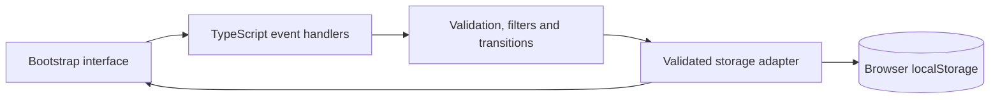

# Mesa — Bootstrap SupportDesk

A responsive request workspace built with **Bootstrap 5.3, SCSS and TypeScript**. Create a request, find it through combined filters, start work, document the resolution and keep its history when reopening.


[Watch the recorded workflow](docs/demo.webm) · [Validation: 33 unit + 9 browser tests](docs/VALIDATION.md) · [Try the hands-on exercise](docs/LEARNING.md)

**Release A:** single-agent demonstration with synthetic data and browser-local persistence. This release has no API, shared database, authentication or cloud backend. Built with AI assistance; the [hands-on guide](docs/LEARNING.md) covers actual modifications and code explanations.

## Run

Node.js **22.12+** is required. From this directory:

```bash
npm ci
npm run dev
```

Open the printed local URL, normally <http://127.0.0.1:4173>. To serve the production build, use `npm run build`, then `npm run preview` on port 4174.

On the current Codex workspace, Node is available in `/tmp/cartagena-node/bin`; add that directory to `PATH` when your shell cannot find `node`. The [local launcher](scripts/start-local.sh) handles this workspace fallback automatically.

## What works

- Responsive Bootstrap grid, request table and mobile cards, forms, modal, offcanvas and toast feedback.
- A compiled SCSS theme with Bootstrap variable overrides and a reusable priority-color mixin.
- Combined text/status/priority/category filtering, sorting and pagination. Search ignores case and accents and includes the displayed request number.
- Validated request creation and New → In progress → Resolved transitions. A resolution note is required; reopening keeps the earlier resolution in history.
- Comments, priority changes and chronological activity. Unrelated draft text survives detail updates.
- Validated version-1 `localStorage` records. A failed save preserves input; corrupt saved bytes are left untouched until explicit reset. Export is available before reset.
- Unit tests and browser tests for the complete workflow, failure recovery, responsive widths and keyboard focus.

## Verify

```bash
npm run check
npm test
npm run build
npx playwright install chromium
npm run test:e2e
```

The browser install is a one-time setup for a new machine. Linux may need Playwright's documented browser system dependencies. A custom executable can be selected through `MESA_CHROMIUM_PATH`; ordinary installations use Playwright's default browser.

See [validation evidence](docs/VALIDATION.md) for actual results and environment details. These checks validate the app, not completion of the user's practice.

## Read the implementation



| File | Responsibility |
|---|---|
| [src/main.ts](src/main.ts) | Rendering, Bootstrap components, events, save feedback and draft preservation |
| [src/domain.ts](src/domain.ts) | Immutable request creation, filters, workflow rules and activity |
| [src/storage.ts](src/storage.ts) | Versioned schema validation and storage failure handling |
| [src/seed.ts](src/seed.ts) | Eight fictional requests with realistic histories |
| [src/types.ts](src/types.ts) | Request, activity and filter types |
| [src/styles.scss](src/styles.scss) | Bootstrap theme, layout, responsive treatment and priority mixin |

[Acceptance stories](docs/ACCEPTANCE.md) · [Hands-on practice](docs/LEARNING.md) · [Actual development log](docs/DEVELOPMENT_LOG.md)

## Scope and limitations

Data belongs to this browser and origin. It is not synchronized or an encrypted/shared customer system. Use synthetic information. Clearing browser storage removes saved requests. The current release does not coordinate simultaneous edits from multiple tabs.

The proposed next release adds FastAPI, durable backend storage and Google Cloud deployment. Those features are not part of this release. This repository records its actual development dates and does not establish a year of Bootstrap employment.
