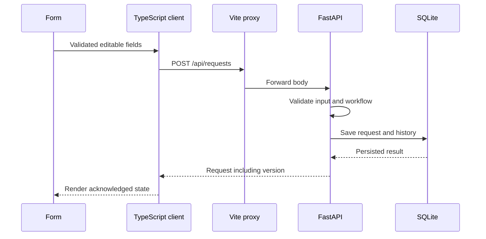

# Mesa's local API: FastAPI, SQLite and conflicts

Prepared October 29, 2026, for the explicitly selected v0.3.0 API release. The frontend type check, 55 frontend unit tests, 48 backend tests, both production builds, 15 browser-mode journeys and six API-mode journeys passed locally on October 29, 2026. A real-process restart check also preserved the full request, resolution and history. This guide explains the contract and study exercises; personal practice is recorded separately.

Read [API setup and contract](API.md) and the source as it is integrated. The retained browser mode remains useful for studying synchronous storage and the original recovery tests. The two modes do not silently exchange data.

## 1. Explain what changed

| Question | Default browser mode | Explicit local API mode |
|---|---|---|
| Where are requests saved? | localStorage under one browser origin | A SQLite file owned by the local backend |
| How does the client save? | Synchronous storage write | Asynchronous HTTP request |
| What survives restart? | A reload at the same origin can read that browser's records | A backend restart using the same database path can read the server's records |
| Can another client see records? | It has its own origin/profile storage | Clients using the same backend read the same database |
| How are stale changes handled? | No cross-tab coordination guarantee | `expectedVersion` mismatch returns HTTP 409 |
| Is there demo reset? | Explicit confirmed reset | Disabled; no API reset endpoint |
| Is this authenticated or cloud-hosted? | No | No: local FastAPI + SQLite only |

The API moves authority for saved records to the backend. The frontend still owns presentation, filters and unsent form drafts.

**Worked answer — “What is the backend for?”**

> The browser can work locally, but its storage belongs to one origin and device. The API mode gives clients
> a common local persistence layer. FastAPI validates operations and SQLite saves the resulting records.
> The request version helps reject stale changes. This extension is local development work, with no login
> or cloud deployment claimed.

## 2. Run and observe the two processes

From the Mesa project directory, install Python dependencies in a virtual environment:

```bash
python3 -m venv backend/.venv
backend/.venv/bin/python -m pip install -r backend/requirements-dev.txt
```

Run the backend in one terminal:

```bash
backend/.venv/bin/python -m uvicorn backend.app:app --host 127.0.0.1 --port 8000
```

Start the frontend in another:

```bash
npm run dev:api
```

Vite serves the UI on 4173 and forwards `/api` to the backend on 8000. Its LAN address can expose those proxied operations to other devices on that network; this is still an unauthenticated local demonstration using synthetic data.

The default SQLite file is `backend/data/mesa.sqlite3`. `MESA_DB_PATH` selects another file at backend startup. The backend seeds fictional records only on initial database creation. An actually empty list returned by the API must not cause the frontend to seed local data.

## 3. Trace a create operation



Open the browser's Network panel and find the request. Inspect its method, path, submitted JSON, response status and response object. A disabled button or spinner is not evidence that the database accepted the change; the returned HTTP result matters.

`CreateInput` includes title, description, customer, category and priority. The saved response also has an identity, timestamps, initial activity and a positive integer `version`. Those extra fields are server-controlled in this contract.

**Worked answer — “Why validate on the server too?”**

> Browser validation helps someone correct a form, and TypeScript helps during development. Neither proves
> that an HTTP caller sent valid data. The server validates the body and enforces transitions before saving.
> A request cannot become resolved directly from new, and resolving needs a note even if someone bypasses
> the normal interface.

## 4. Study optimistic concurrency

Consider two clients that read the same request at version 1:

1. Client A submits a comment with `expectedVersion: 1`.
2. The server accepts that current version and returns the saved result with its new version.
3. Client B still holds the earlier record and submits a priority change with `expectedVersion: 1`.
4. The server rejects that stale mutation with HTTP 409 rather than overwriting A's newer result.
5. B refreshes, retains useful draft text and asks the person to review the current request before retrying.

`expectedVersion` is a precondition on a mutation, not a timestamp, database password or user identity. A record's version is different from the browser's `{version: 1, requests: [...]}` **storage format**. The browser envelope version describes its schema; the API record version detects intervening updates.

**Worked answer — “Why not just retry the same change?”**

> The current request may now have a different status or priority. Automatically replaying an operation
> could discard that context. I refresh the server record and preserve the draft so the person can decide
> whether the original action still makes sense, then submit using the current version.

## 5. Explain the error classes

| Outcome | Meaning | Useful reaction |
|---|---|---|
| 404 | Missing request ID | Refresh and explain that the record is unavailable |
| 409 | Stale version, conflicting transition or creation-key conflict | Refresh, preserve drafts, review and retry deliberately |
| 422 | Invalid fields or a command missing required content | Show actionable validation feedback and retain useful input |
| 503 | Backend database read/write failure | Explain the storage failure and retain useful input |
| Failed connection/service | No acknowledged success | Explain the problem, offer retry and stay in API mode |

API mode must not treat server failure as permission to save a different localStorage copy. That would create two competing stores while implying the operation succeeded.

A response can be lost after the backend saved a create operation. Mesa's pending creation form supplies an optional `Idempotency-Key` header to protect an explicit retry with the same input. The backend stores the key, normalized input hash and request ID in one SQLite transaction. The same key/input returns the existing record; a different input under that key returns 409. A caller omitting the header does not receive that replay protection.

The pending key survives closing/reopening the form while its result is uncertain. It is held in memory, so after a page reload inspect the list before starting another creation. If input changes after an uncertain create, refresh/review before starting a new keyed attempt. For other commands, uncertainty blocks mutations until refresh: there is no automatic replay of a possibly saved comment or transition. Inspect activity before retrying. Do not transfer the browser quota test's synchronous guarantees to HTTP without understanding this distinction.

**Worked answer — “What does SQLite add?”**

> The backend persists records in a database file instead of keeping them only in process memory. Restarting
> with the same database path should preserve them, and that needs a real restart check. A local database
> file does not by itself establish a cloud service, backup policy, authentication or production readiness.

The real-process restart check was verified on October 29: a request created and moved through start/comment/resolution survived stopping Uvicorn and restarting an independent process on the same temporary file, with the version-4 record unchanged and no duplicate seeds. [Recorded evidence](api-restart-validation.json). API browser tests separately exercised recovery; this one restart check does not establish all error behavior.

## 6. Three concrete study exercises

### A. Follow an acknowledged save

Create a synthetic request, record the returned ID/version and retrieve it again. Add one comment with that version and compare the returned activity and version. Explain which fields the browser supplied and which the server assigned.

Expected observation: the GET returns the saved record; a successful mutation returns the current state/version. Record the actual result rather than assuming it from the example.

### B. Reproduce a conflict

Use two clients to read one record. Save a comment in A, then try to change priority from B using its earlier version. Inspect HTTP 409 and the displayed feedback. Refresh B and review whether the priority change is still appropriate.

Expected observation: A's comment remains; the stale mutation does not overwrite it; useful B draft text remains available for review. This is a proposed exercise, not a record that José completed it.

### C. Distinguish restart persistence from fallback

Save a synthetic record, stop the backend and attempt a new operation. Inspect the visible connection error. Restart with the same database path and inspect the earlier saved record.

Expected observation: API mode stays selected, does not import localStorage or enable demo reset, and the acknowledged earlier save remains in SQLite after restart. If an attempted save's result was uncertain, inspect before replaying it.

## 7. Tests worth explaining

Useful backend tests target input/workflow validation, missing IDs, version conflicts and transaction consistency. Use isolated database files so tests do not alter normal demo data. A persistence test should exercise a new application/database connection to the same file, not only read the same in-memory object again.

Frontend API tests should verify acknowledged save handling, visible service errors, stale-version refresh, draft preservation and absence of browser-storage fallback. Existing browser quota/corrupt-JSON tests remain browser-mode tests; their passing results do not prove API integration.

A review should distinguish test intent, execution evidence and remaining limits. Root confirmed six API browser cases passing against the production frontend, plus frontend type/unit/build checks. The 48 backend cases and 15 default-browser regression journeys also passed. No coverage percentage or benchmark is established. See [VALIDATION.md](../docs/VALIDATION.md) for the current record.

## 8. Read the implementation and explain the boundary

- [backend/app.py](../backend/app.py): HTTP routes, server-side input/workflow handling and persistence entry points.
- [backend/models.py](../backend/models.py), [backend/domain.py](../backend/domain.py) and [backend/repository.py](../backend/repository.py): input boundaries, lifecycle rules, transactions, versions and replay keys.
- [Backend runtime requirements](../backend/requirements.txt) and [test requirements](../backend/requirements-dev.txt): reproducible Python dependencies.
- [vite.config.ts](../vite.config.ts): `/api` proxy to the local service.
- [src/main.ts](../src/main.ts): selected-mode initialization, asynchronous actions, rendering and unsent drafts.
- [src/api.ts](../src/api.ts): HTTP client, response validation, expected versions and uncertain outcomes.
- [src/storage.ts](../src/storage.ts): the retained browser mode; this is not the SQLite implementation.
- [Development log](../docs/DEVELOPMENT_LOG.md): assistance, actual verification and separate learner practice.

Keep application wording precise: **local FastAPI API with SQLite persistence** after implementation/verification. Add cloud delivery or authentication only if those features are actually implemented later.
